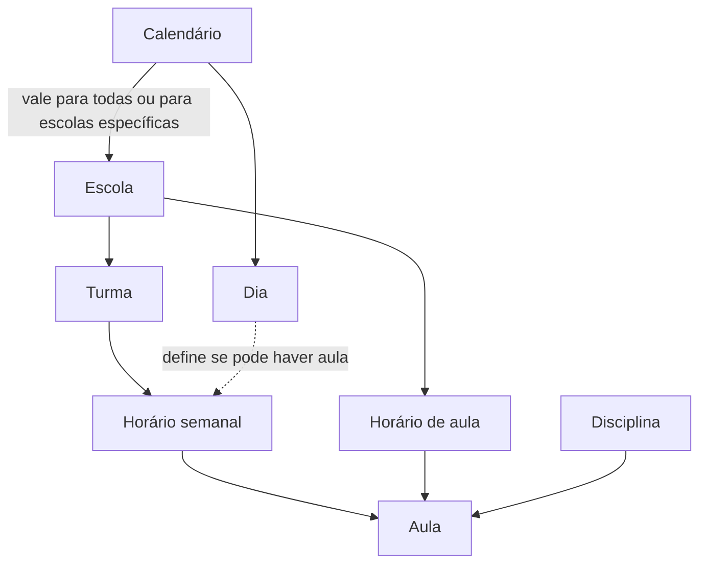

# Calendário Acadêmico e Horário Semanal

Este documento explica como funcionam o **Calendário Acadêmico** e o **Horário Semanal**, e os cadastros de apoio que eles usam: escolas (com seus horários de aula), disciplinas e turmas. Foi escrito para quem usa o sistema e para quem define o negócio.

## Sumário

1. [Visão geral](#1-visão-geral)
2. [Quem acessa](#2-quem-acessa)
3. [Calendário acadêmico](#3-calendário-acadêmico)
4. [Cadastros de apoio](#4-cadastros-de-apoio)
5. [Horário semanal](#5-horário-semanal)
6. [Passo a passo nas telas](#6-passo-a-passo-nas-telas)
7. [Limitações conhecidas](#7-limitações-conhecidas)

---

## 1. Visão geral

| Funcionalidade | Para que serve |
|---|---|
| **Calendário acadêmico** | Define, para um ano letivo, o tipo de cada dia (letivo, não letivo, facultativo etc.). Pode valer para todas as escolas ou só para algumas. |
| **Horário semanal** | Monta as aulas de **uma turma** em **uma semana** (segunda a domingo). Cada aula combina um **horário de aula da escola** (ex.: "1ª aula, 07:00 às 07:50") com uma **disciplina**. Só aceita aulas em dias letivos. |
| **Cadastros de apoio** | Escolas e seus horários de aula, disciplinas e turmas. São a matéria-prima do calendário e do horário. |

**Como se relacionam:** o horário semanal consulta o calendário para saber, data a data, se há aula. Ao salvar, ele guarda como cada dia estava no calendário naquele momento. Se o calendário mudar depois, o horário avisa que está desatualizado (seção 5.8).

---

## 2. Quem acessa

- Podem usar essas telas os mesmos usuários que podem cadastrar funcionários.
- Cada rede de ensino vê e altera somente os próprios dados. Dados de outra rede nunca aparecem, e um item de outra rede é tratado como "não encontrado".
- Quem não tem a permissão é levado de volta ao painel inicial ao tentar abrir a tela pelo endereço.
- É preciso ter uma rede de ensino selecionada. Sem ela, o sistema pede: "Selecione um tenant para continuar." Se a rede selecionada não for acessível ao usuário, aparece: "Você não tem acesso ao tenant selecionado. Troque o tenant ativo."

---

## 3. Calendário acadêmico

### 3.1 O que é

Um calendário tem **nome**, **ano letivo**, **período** (data de início e de fim dentro do ano) e **abrangência**. Para cada data do período existe um dia com seu tipo e uma descrição opcional.

- O ano letivo vai de 2000 a 2100.
- O período precisa estar dentro do ano e o início não pode ser depois do fim. Exemplo: para 2026, de 02/02/2026 a 18/12/2026.
- É possível ter vários calendários para o mesmo ano e as mesmas escolas. O sistema não impede isso; a regra de qual vale está na seção 5.3.

### 3.2 Os cinco tipos de dia

| Tipo | Permite aulas no horário semanal? |
|---|---|
| Dia letivo | Sim |
| Dia não letivo | Não |
| Ponto facultativo | Não |
| Planejamento de aula | Não |
| Formação pedagógica | Não |

### 3.3 Como os dias são preenchidos ao criar

Ao criar o calendário, o sistema já cria todos os dias do período, inclusive o primeiro e o último:

| Dia da semana | Tipo inicial |
|---|---|
| Segunda a sexta | Dia letivo |
| Sábado | Dia não letivo |
| Domingo | Dia não letivo |

Exemplo: um calendário de 02/02/2026 a 18/12/2026 nasce com todas as segundas a sextas como letivas e todos os fins de semana como não letivos. Feriados e recessos precisam ser ajustados depois, dia a dia.

### 3.4 O que pode ser alterado em um dia

| Dia | Tipo | Descrição |
|---|---|---|
| Domingo | **Não pode mudar**: é sempre dia não letivo. | Pode ser alterada. |
| Sábado | Pode virar qualquer um dos cinco tipos (ex.: sábado letivo de reposição). | Pode ser alterada. |
| Segunda a sexta | Pode virar qualquer um dos cinco tipos. | Pode ser alterada. |

- A descrição aceita até 1000 caracteres. Apagar o texto remove a descrição.
- Só é possível editar datas que estão dentro do período do calendário. Fora dele, aparece "Este dia está fora do período do calendário."
- Ao tentar mudar o tipo de um domingo: "O domingo é sempre dia não letivo; só a descrição pode ser alterada."

Exemplo: o sábado 03/10/2026 pode ser marcado como Dia letivo com a descrição "Sábado letivo de reposição".

### 3.5 Visões e quantitativos

O calendário pode ser visto por **dia**, **semana**, **mês** ou **ano**, sempre a partir de uma data escolhida:

| Visão | Período exibido | Exemplo com a data 02/10/2026 |
|---|---|---|
| Dia | Só a data | 02/10/2026 |
| Semana | Domingo a sábado | 27/09 a 03/10/2026 |
| Mês | Do dia 1 ao último dia do mês | 01/10 a 31/10/2026 |
| Ano | 1º de janeiro a 31 de dezembro | 01/01 a 31/12/2026 |

Se o período da visão começar antes ou terminar depois do calendário, aparecem apenas os dias que existem nele.

O **quantitativo** mostra quantos dias há de cada um dos cinco tipos e o total. Na tela do calendário, ele considera só o período que está sendo exibido; ao abrir um calendário, o resumo considera o calendário inteiro.

### 3.6 Para quais escolas vale

- **Todas as escolas** da rede de ensino; ou
- **Escolas específicas**: é preciso escolher ao menos uma, e só escolas da própria rede, que existam e não tenham sido excluídas.

Mensagem quando a escolha é inválida: "Selecione ao menos uma escola válida do tenant, ou marque "Todas as escolas"."

### 3.7 O que pode ser editado depois de criado

| Item | Pode editar? |
|---|---|
| Nome | Sim |
| Abrangência (todas ou escolas específicas) e a lista de escolas | Sim. Ao escolher "todas as escolas", a lista anterior é descartada. Ao trocar para escolas específicas, é preciso escolher ao menos uma. A nova lista substitui a anterior. |
| Ano letivo e período | **Não.** Para outro período, é preciso criar um novo calendário. |
| Tipo e descrição de cada dia | Sim (seção 3.4) |
| Acrescentar ou remover dias | Não. Os dias são fixos pelo período. |

### 3.8 Exclusão

Ao excluir, o calendário e todos os seus dias deixam de aparecer. A tela pede confirmação ("Esta ação não pode ser desfeita"). Consequências:

- O sistema **não impede** a exclusão de um calendário que já foi usado em horários semanais.
- Os horários semanais que se baseavam nele passam a aparecer como **desatualizados** (seção 5.8), mas mantêm as aulas.
- O calendário deixa de ser considerado em novos horários.

---

## 4. Cadastros de apoio

### 4.1 Escolas

- Têm nome (2 a 191 caracteres) e situação ativa ou inativa.
- O nome é único dentro da rede de ensino, **inclusive entre escolas excluídas**. Mensagem: "Já existe uma escola com este nome (inclusive entre as excluídas)."
- Ao excluir, a escola some das listas, mas o nome continua reservado. O sistema não verifica se há turmas, calendários ou horários ligados a ela.
- A lista tem busca por nome, filtro por situação e paginação.

### 4.2 Horários de aula da escola

Um horário de aula é um intervalo nomeado, como "1ª aula, 07:00 às 07:50", que vale para todos os dias da semana. Fica dentro da edição da escola, na seção "Horários das aulas" (não aparece ao criar uma escola nova, apenas ao editar).

| O que é permitido | O que é impedido |
|---|---|
| Horários em formato 24 horas, de 00:00 a 23:59. | Fim igual ou anterior ao início: "O fim do horário deve ser depois do início." |
| Horários que se encostam: 07:00–07:50 e 07:50–08:40 na mesma escola. | Dois horários de aula da mesma escola **não podem se sobrepor**: "Este horário se sobrepõe a outro horário de aula da escola." |
| Mesmo nome em escolas diferentes. | Dois horários com o mesmo nome na mesma escola: "Já existe um horário com este nome na escola." |
| Reaproveitar o nome de um horário já excluído. | Excluir um horário que já é usado em aulas de algum horário semanal: "Este horário é usado em aulas do horário semanal e não pode ser excluído." |
| Alterar o horário de um horário de aula já usado. As aulas passam a mostrar as horas novas. | |

- O nome tem de 1 a 60 caracteres.
- A **posição** define a ordem de exibição. Se não for informada, o horário vai para o fim da lista.
- Alterar um horário de aula **não** marca os horários semanais como desatualizados.

### 4.3 Disciplinas

- Têm nome (2 a 191 caracteres) e situação ativa ou inativa.
- O nome é único na rede de ensino, inclusive entre disciplinas excluídas: "Já existe uma disciplina com este nome (inclusive entre as excluídas)."
- Ao excluir, a disciplina deixa de aparecer, mas o nome continua reservado. O sistema **não impede** excluir uma disciplina que já está em horários (ver limitações).
- A lista tem busca, filtro por situação e paginação.

### 4.4 Turmas

- Pertencem a uma escola e a um ano letivo, e têm nome e situação (ativa ou inativa).
- A escola precisa existir e não estar excluída: "A escola selecionada não existe, foi excluída ou está inativa." Na prática, uma escola inativa (mas não excluída) ainda é aceita.
- O nome é único dentro da mesma escola e do mesmo ano, inclusive entre turmas excluídas: "Já existe uma turma com este nome nesta escola e ano letivo." O mesmo nome pode existir em anos diferentes (ex.: "8º A" em 2026 e em 2027).
- Depois de criada, **só o nome e a situação podem mudar**. Escola e ano ficam somente leitura.
- A lista pode ser filtrada por escola, ano, nome e situação.
- Turmas inativas continuam no cadastro.

---

## 5. Horário semanal

### 5.1 A semana e as aulas

- Cada horário cobre uma semana completa, **de segunda a domingo**. Exemplo: de **28/09/2026 (segunda) a 04/10/2026 (domingo)**. Se a semana não for assim: "A semana deve ir de segunda a domingo, tocar o ano letivo da turma e ser diferente da semana de origem."
- A semana precisa tocar o ano letivo da turma. A semana de 28/12/2026 a 03/01/2027 serve tanto para uma turma de 2026 quanto para uma de 2027.
- Uma turma tem **no máximo um horário por semana**: "A turma já tem horário para esta semana."
- Em cada dia, uma aula é montada escolhendo o **horário de aula da escola** e a **disciplina**. Os horários de início e fim vêm do horário de aula escolhido; não são digitados.
- O horário de aula precisa ser da escola da turma: "Um ou mais horários de aula não pertencem à escola da turma. Recarregue o horário."
- A disciplina precisa existir na rede: "Uma ou mais disciplinas não existem mais neste tenant."
- Um dia não pode ter o mesmo horário de aula duas vezes: "Há aulas do mesmo dia no mesmo horário ou com horários que se cruzam."
- Cada dia comporta até 20 aulas, exibidas em ordem de horário.
- Depois de criado, o horário não muda de turma nem de semana.

Exemplo, turma "8º A" de 2026, semana de 28/09 a 04/10/2026:

| Dia | Aulas |
|---|---|
| Seg 28/09 | 1ª aula (07:00–07:50) Matemática; 2ª aula (07:50–08:40) Português |
| Ter 29/09 | 1ª aula (07:00–07:50) Português |
| Qua 30/09 a Sex 02/10 | Sem aulas lançadas |
| Sáb 03/10 | Não letivo, sem aulas |
| Dom 04/10 | Sem aulas |

### 5.2 Escolhendo a semana na tela

Ao criar, o usuário escolhe a escola, a turma e **qualquer data** da semana. O sistema ajusta para a segunda-feira daquela semana.

### 5.3 Qual calendário vale

Para cada data da semana, o sistema considera os calendários que valem para a escola da turma (os que são para todas as escolas e os que incluem aquela escola) e escolhe um:

| Situação na data | Resultado |
|---|---|
| Existe calendário **da escola** e calendário **geral** | Vale o **da escola**. O específico tem prioridade. |
| Existe mais de um calendário do mesmo nível | Vale o criado primeiro, de forma fixa e previsível. |
| Nenhum calendário cobre a data | O dia fica "Fora do calendário" e não tem aula. |
| Nenhuma data da semana é coberta | O horário não pode ser salvo: "Nenhum dia da semana está coberto por um calendário acadêmico da escola da turma." |

Isso permite montar a primeira e a última semana do ano letivo, que podem ter dias fora do calendário.

Exemplo: o calendário geral de 2026 mantém o sábado 03/10 como não letivo, mas o calendário específico da escola o marca como letivo. Para a turma dessa escola, o sábado é letivo.

### 5.4 Dias sem aula

Só o **Dia letivo** aceita aulas. Dia não letivo, ponto facultativo, planejamento, formação e datas fora do calendário não têm aula.

- Na tela, esses dias mostram "Sem aulas: o dia não é letivo." Dias letivos mostram "Adicionar aula".
- Tentar salvar aula em um dia assim: "Só dias letivos podem ter aulas. Remova as aulas dos demais dias."
- O que vale é o tipo do dia **no momento em que o horário foi salvo**, não o calendário de hoje (ver seção 5.8).

### 5.5 Sábado letivo sem aula

Se um sábado é letivo, ele precisa ter **ao menos uma aula** para o horário ser salvo: "O sábado é letivo e precisa de ao menos uma aula para salvar." Na tela, o sábado letivo vazio fica destacado com "Sábado letivo: inclua ao menos uma aula."

Exemplo: se o sábado 03/10/2026 foi marcado como letivo, o horário de 28/09 a 04/10 só salva com pelo menos uma aula nesse sábado. Se o sábado continua não letivo, não há exigência. O domingo nunca é letivo. A mesma regra vale ao editar e ao replicar.

### 5.6 Registro de conteúdo e frequência

Cada aula tem duas marcações independentes: **Conteúdo** registrado e **Frequência** registrada.

- As marcações ficam disponíveis só depois que o horário foi salvo: "Salve o horário para registrar a aula."
- Cada clique grava na hora e pode ser desfeito, desmarcando.
- **Uma aula com qualquer marcação é considerada registrada e não pode ser alterada nem removida**: nem o dia, nem o horário de aula, nem a disciplina. O horário inteiro também não pode ser excluído. Mensagem: "Aulas com conteúdo ou frequência registrados não podem ser alteradas nem excluídas." Para liberar, desmarque os registros.
- Na tela, os ícones de editar e remover aparecem bloqueados: "Aula registrada: não pode ser alterada nem excluída."
- Ao editar o horário, uma aula idêntica (mesmo dia, horário de aula e disciplina) mantém as marcações.
- A lista mostra quantas aulas cada horário tem.

### 5.7 Edição e exclusão

- **Editar:** o usuário reorganiza os dias e as aulas e salva. Todas as regras acima são conferidas de novo, usando o calendário de agora. Aulas registradas precisam continuar como estão.
- **Excluir:** remove o horário da semana. Não é permitido se houver alguma aula registrada (o botão fica desabilitado: "Há aulas registradas: o horário não pode ser excluído").

### 5.8 Situação: atualizado ou desatualizado

Cada horário mostra um selo:

| Situação | Quando aparece | Dica na tela |
|---|---|---|
| **Atualizado** | Todos os dias continuam como estavam no calendário quando o horário foi salvo. | "O horário está de acordo com o calendário acadêmico." |
| **Desatualizado** | O calendário usado foi excluído, o dia deixou de existir nele ou o tipo do dia mudou. | "O calendário acadêmico mudou depois que o horário foi salvo." |

- É só um aviso. O horário **não é alterado sozinho** e as aulas continuam lá.
- Para atualizar, abra o horário e salve de novo: o sistema passa a usar o calendário vigente.
- Exemplo: o horário de 28/09 a 04/10 foi salvo com a sexta 02/10 letiva. Se alguém mudar 02/10 para ponto facultativo no calendário, o horário passa a aparecer como desatualizado até ser salvo novamente.
- Não geram o aviso: criar depois um calendário que cubra datas que estavam sem calendário, criar depois um calendário da escola que passe a ter prioridade, ou alterar um horário de aula da escola.

### 5.9 Replicação para outras semanas

Copia o padrão de uma semana para outras semanas da **mesma turma**.

- Informe de 1 a 20 semanas de destino, escolhendo uma data qualquer de cada. O sistema ajusta para a segunda-feira. Não vale repetir semana nem usar a semana de origem, e todas precisam tocar o ano letivo da turma.
- A cópia é feita **por dia da semana**: segunda copia para segunda, terça para terça, e assim por diante.
- O calendário de cada semana de destino é consultado, com a mesma prioridade da escola.

O que acontece em cada caso:

| Situação na semana de destino | Resultado |
|---|---|
| A turma ainda não tem horário nessa semana | O horário é **criado**. |
| A turma já tem horário nessa semana | O horário é **sobrescrito**: as aulas sem registro são substituídas; as **aulas registradas são preservadas**. |
| O dia de destino não é letivo (feriado, recesso etc.) | As aulas desse dia são **descartadas** ("Dia não letivo na semana alvo"). A cópia segue normalmente. |
| Uma aula copiada cruza com uma aula registrada preservada | A aula copiada é **descartada** ("Conflita com aula já registrada na semana alvo"). |
| A aula copiada é igual a uma registrada (mesmo horário de aula e mesma disciplina) | A registrada permanece e não gera cópia nem aviso. |
| Sábado letivo na semana de destino ficaria sem aula | A replicação é recusada (seção 5.5). |

**Tudo ou nada:** se qualquer semana de destino falhar em alguma validação, nenhuma semana é criada nem sobrescrita.

Ao concluir, uma janela "Replicação concluída" resume: semanas criadas, sobrescritas, aulas preservadas e descartadas, com o motivo de cada descarte. Se nada foi descartado nem preservado, a mensagem é "Todas as aulas foram copiadas."

Exemplo: origem 28/09 a 04/10/2026 (segunda a sexta com aulas), destinos 05/10 e 12/10. Suponha que a segunda 12/10 seja dia não letivo.

| Semana de destino | Resultado |
|---|---|
| 05/10 a 11/10 | Criada, todas as aulas copiadas. |
| 12/10 a 18/10 | Criada. As aulas de segunda (12/10) são descartadas por dia não letivo; terça a sexta são copiadas. |

Se a semana de 12/10 já existisse com a aula de Matemática da quarta-feira registrada na 1ª aula, e a origem trouxesse Português nessa mesma 1ª aula da quarta, a de Matemática seria preservada e a de Português descartada por conflito.

---

## 6. Passo a passo nas telas

### 6.1 Onde fica no menu

| Item | Local |
|---|---|
| Calendário Acadêmico | Item solto, no topo do menu |
| Escolas, Disciplinas, Turmas, Horário Semanal | Grupo "Acadêmico" |

Os horários de aula da escola não têm item próprio: ficam na edição da escola.

### 6.2 Fluxo recomendado

1. Cadastre as **escolas** e, em cada uma, os **horários das aulas**.
2. Cadastre as **disciplinas**.
3. Cadastre as **turmas** (escola, ano e nome).
4. Crie o **calendário acadêmico** e ajuste os dias que não são letivos (feriados, recessos) e os sábados letivos.
5. Monte o **horário semanal** de cada turma e, se for o caso, replique para as demais semanas.

### 6.3 Calendário acadêmico

- A lista mostra cada calendário com nome, ano, período e escolas, e pode ser filtrada por ano letivo e por escola.
- "Novo calendário" pede ano, nome, período e a abrangência: o interruptor "Todas as escolas" ou a escolha de escolas específicas.
- Na edição, ano e período aparecem como "não editáveis".
- Ao abrir um calendário, ele abre no dia de hoje, se estiver no período, ou no início. Use Dia, Semana, Mês e Ano e as setas de período anterior e próximo (travadas nos limites do calendário). Clicar em um mês na visão Ano leva à visão Mês.
- A faixa "Quantitativo do período" mostra os cinco tipos e o total. Cada tipo tem uma cor.
- "Editar dia" abre o tipo e a descrição. No domingo o tipo fica travado, com a nota "Domingo é sempre dia não letivo. Só a descrição pode ser alterada."

### 6.4 Escolas, disciplinas e turmas

- Cada tela tem lista com busca e filtros, criação, edição e exclusão.
- Na edição de uma escola, a seção "Horários das aulas" permite adicionar, editar e excluir horários. Sem nenhum cadastrado: "Nenhum horário cadastrado. Cadastre os horários para montar o horário semanal das turmas."
- Ao excluir disciplina ou escola, o aviso lembra que o item deixa de aparecer na lista e que o nome continua reservado.

### 6.5 Horário semanal

**Lista:** filtros por escola, turma e período (De e Até). Cada linha traz o período da semana, o selo atualizado ou desatualizado, a turma, o número de aulas e a data de criação. As ações são editar, replicar e excluir.

**Criar:** "Novo horário" pede escola, turma e uma data da semana, e abre o editor.

**Editor:** mostra a semana de segunda a domingo, uma coluna por dia.
- Em dias letivos, "Adicionar aula" pede o **horário de aula da escola** e a **disciplina**. Os horários já usados no dia aparecem desabilitados.
- Se a escola não tiver horários cadastrados: "A escola desta turma não tem horários de aula cadastrados. Cadastre-os na aba Escolas (editar a escola → Horários das aulas) para incluir aulas."
- Em semana nova, o editor já mostra o tipo de cada dia segundo o calendário vigente; dias sem calendário aparecem como "Fora do calendário".
- Os botões **Conteúdo** e **Frequência** em cada aula registram na hora, só com o horário já salvo.
- "Salvar" aplica todas as regras. Se algo falhar, uma faixa de erro mostra a mensagem. O sábado letivo sem aula é barrado antes mesmo de enviar.

**Replicar:** em "Replicar para outras semanas", adicione uma data de cada semana de destino. O aviso na tela diz: "Semanas que já têm horário serão sobrescritas; aulas com registro são preservadas. Aulas em dias não letivos da semana alvo são descartadas."

---

## 7. Limitações conhecidas

1. **Horário que pode ficar impossível de editar.** Se a disciplina de uma aula registrada for excluída, ou se o dia deixar de ser letivo depois do registro, não dá para manter a aula (o sistema recusa), nem remover (aula registrada), nem excluir o horário. Saída: desmarcar conteúdo e frequência da aula e só então ajustar. A replicação preserva essas aulas normalmente.
2. **Exclusões sem verificação de uso.** Excluir disciplina, turma, escola ou calendário não é barrado por existirem horários semanais ligados a eles. O único bloqueio é o de horários de aula da escola em uso.
3. **Aviso de "desatualizado" é parcial.** Ele não detecta calendário novo criado depois, calendário da escola que passa a ter prioridade sobre o geral, nem mudança nos horários de aula da escola (seção 5.8).
4. **Limite de 100 itens nos seletores.** Escolas, turmas e disciplinas usadas no horário e no cadastro de turmas mostram no máximo 100 opções, sem paginação. Na previsão da semana nova, são lidos no máximo 100 calendários da escola.
5. **Filtro por escola na lista de horários vale só para a página exibida.** O sistema filtra por turma, não por escola. Ao escolher só a escola, a filtragem acontece sobre a página carregada; por isso o total e a paginação continuam contando todas as escolas e uma página pode aparecer parcial ou vazia.
6. **Aulas guardam suas marcações só enquanto idênticas.** Ao editar, se a aula mudar de dia, horário de aula ou disciplina, ela é tratada como outra aula (e, se estava registrada, a edição é recusada).
7. **Nome só com espaços.** Em escolas, calendários, disciplinas e turmas, um nome formado só por espaços pode passar pela validação e ser gravado vazio.
8. **Calendários coincidentes.** O sistema permite vários calendários para o mesmo ano e as mesmas escolas. Nesse caso vale o criado primeiro, o que pode surpreender.
9. **Filtro com data inicial maior que a final** na lista de horários devolve lista vazia, sem aviso.
10. **Edições simultâneas.** Duas pessoas criando a mesma semana da mesma turma ao mesmo tempo, ou registrando uma aula enquanto outra pessoa exclui o horário, podem causar resultados inesperados. Situações raras.
